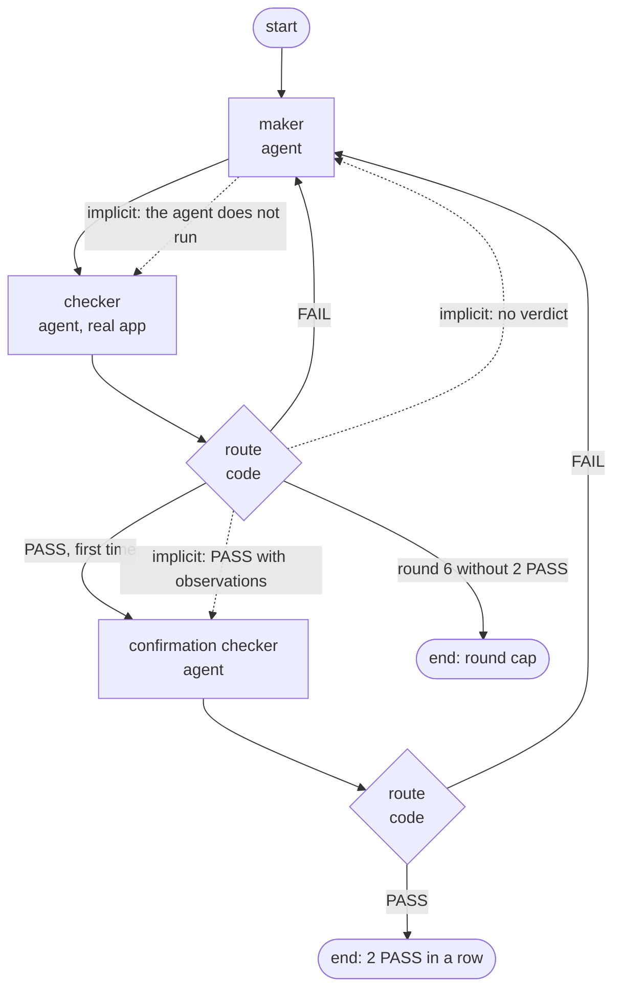

# The P07 maker-checker loop, drawn as a graph

P08 experiment 1: take the loop in `scripts/p07-maker-checker.sh` and explicitly write down its nodes, edges, shared state and routing rules, to find the decisions that were hidden in the script or in the agent's context.

## Diagram



The dotted edges are the **implicit** ones: they existed in the actual P07 behavior, but were not written down as decisions.

## Nodes

| Node | Type | Responsibility | Inputs | Outputs |
|---|---|---|---|---|
| maker | Agent | Implement the search and fix the defects from the previous verdict | `maker.md`, `AGENTS.md`, `loop-state.md`, `checker-verdict.md` | Code, tests, entry in `loop-state.md`, commit |
| checker | Agent | Verify in the real app; does not touch code | `checker.md`, the repo | `checker-verdict.md` (`VERDICT: PASS/FAIL` + defects), entry in `loop-state.md` |
| confirmation checker | Agent | The same checker, in a round with no changes, to require 2 PASS in a row | Same as the checker | Same as the checker |
| route | Code (`p07-maker-checker.sh`) | Read the first line of the verdict and decide the next node | `checker-verdict.md` | Next node |

## Shared state

| Field | Where it lives | Who writes | Who reads |
|---|---|---|---|
| Task | `maker.md` / `checker.md` | Human (before starting) | maker, checker |
| Code and tests | The repo (commits) | maker | checker |
| Verdict | `checker-verdict.md`, first line | checker | route, maker |
| Defects | `checker-verdict.md`, numbered list | checker | maker |
| Round history | `loop-state.md` | maker and checker | maker, checker, human |
| Current round and consecutive PASSes | Script variables | route | route |

## Routing rules

```
if verdict == FAIL                          → maker
if verdict == PASS and the previous was not PASS → confirmation checker (the maker does not work)
if verdict == PASS and the previous was PASS     → end
if round == 6                               → end (cap)
```

## Implicit edges that appeared when drawing it

1. **"PASS with observations" has no destination.** The P07 checker returned PASS and listed three non-blocking observations (it trims spaces, the counter shows the total, the list does not refresh when importing through the API). The routing only looks at the first line, so those observations **were lost**: nobody receives them. My script even counted them as "defects" in the summary. An explicit edge is needed: PASS with observations → record them as future tasks (or as a question to the human), not discard them.
2. **"No verdict" falls through to FAIL without saying so.** If the checker does not write `checker-verdict.md`, the script reads `NO VERDICT`, which is not PASS, and goes back to the maker. It is a real decision (treating the absence of evidence as failure) that was not written down.
3. **"The agent did not run" does not exist as a state.** In the P07 goal loop, a round failed with `claude: command not found` and the loop counted it as "no progress", the same as if the agent had worked and failed. An infrastructure failure and an agent failure should go along different edges (retry versus count as a round).
4. **The confirmation round is not independent.** The "second PASS" comes from the same kind of checker, with the same instructions, on the same code. It confirms stability; it does not give a second perspective.

Edges 1 and 4 are the ones the experiment 3 graph resolves: two different verifiers in parallel (functional and code review), a rollback edge based on **the layer** where the problem is, and a human-approval node before the merge.
