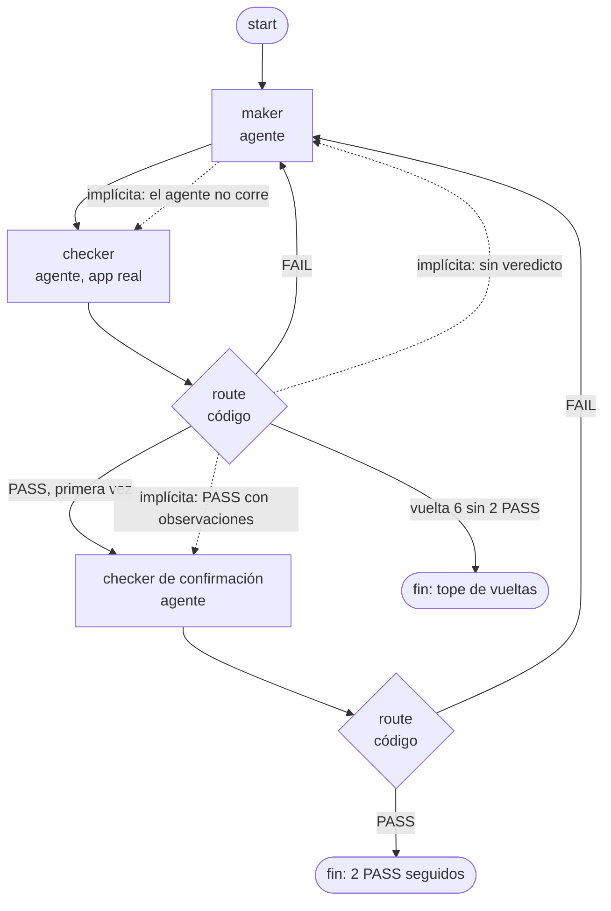

# El loop maker-checker del P07, dibujado como grafo

Experimento 1 del P08: tomar el loop de `scripts/p07-maker-checker.sh` y escribir explícitamente sus nodos, aristas, estado compartido y reglas de ruteo, para encontrar las decisiones que vivían escondidas en el script o en el contexto del agente.

## Diagrama



Las aristas punteadas son las **implícitas**: existían en el comportamiento real del P07, pero no estaban escritas como decisión.

## Nodos

| Nodo | Tipo | Responsabilidad | Entradas | Salidas |
|---|---|---|---|---|
| maker | Agente | Implementar la búsqueda y corregir los defectos del veredicto anterior | `maker.md`, `AGENTS.md`, `loop-state.md`, `checker-verdict.md` | Código, tests, entrada en `loop-state.md`, commit |
| checker | Agente | Verificar en la app real; no toca código | `checker.md`, el repo | `checker-verdict.md` (`VERDICT: PASS/FAIL` + defectos), entrada en `loop-state.md` |
| checker de confirmación | Agente | El mismo checker, en una vuelta sin cambios, para exigir 2 PASS seguidos | Igual que el checker | Igual que el checker |
| route | Código (`p07-maker-checker.sh`) | Leer la primera línea del veredicto y decidir el siguiente nodo | `checker-verdict.md` | Siguiente nodo |

## Estado compartido

| Campo | Dónde vive | Quién escribe | Quién lee |
|---|---|---|---|
| Tarea | `maker.md` / `checker.md` | Humano (antes de empezar) | maker, checker |
| Código y tests | El repo (commits) | maker | checker |
| Veredicto | `checker-verdict.md`, primera línea | checker | route, maker |
| Defectos | `checker-verdict.md`, lista numerada | checker | maker |
| Historia de vueltas | `loop-state.md` | maker y checker | maker, checker, humano |
| Vuelta actual y PASS seguidos | Variables del script | route | route |

## Reglas de ruteo

```
if veredicto == FAIL                       → maker
if veredicto == PASS y el anterior no era PASS → checker de confirmación (el maker no trabaja)
if veredicto == PASS y el anterior era PASS    → fin
if vuelta == 6                             → fin (tope)
```

## Aristas implícitas que aparecieron al dibujarlo

1. **"PASS con observaciones" no tiene destino.** El checker del P07 dio PASS y listó tres observaciones no bloqueantes (recorta espacios, el contador muestra el total, la lista no se refresca al importar por API). El ruteo solo mira la primera línea, así que esas observaciones **se perdieron**: nadie las recibe. Mi script incluso las contó como "defectos" en el resumen. Hace falta una arista explícita: PASS con observaciones → registrarlas como tareas futuras (o como pregunta al humano), no descartarlas.
2. **"Sin veredicto" cae a FAIL sin decirlo.** Si el checker no escribe `checker-verdict.md`, el script lee "SIN VEREDICTO", que no es PASS, y vuelve al maker. Es una decisión real (tratar la ausencia de evidencia como falla) que no estaba escrita.
3. **"El agente no corrió" no existe como estado.** En el loop de objetivo del P07, una vuelta falló con `claude: command not found` y el loop la contó como "sin progreso", igual que si el agente hubiera trabajado y fallado. Una falla de infraestructura y una falla del agente deberían ir por aristas distintas (reintentar contra contar como vuelta).
4. **La vuelta de confirmación no es independiente.** El "segundo PASS" lo da el mismo tipo de checker, con las mismas instrucciones, sobre el mismo código. Confirma estabilidad, no da una segunda mirada.

Las aristas 1 y 4 son las que el grafo del experimento 3 resuelve: dos verificadores distintos en paralelo (funcional y revisión de código), una arista de vuelta atrás según **la capa** donde está el problema, y un nodo humano antes del merge.
