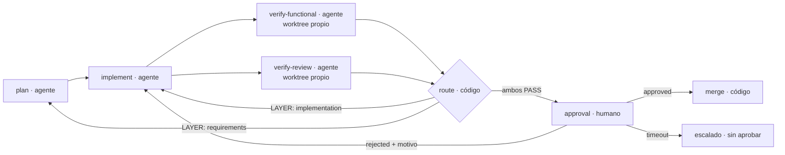

# P08 · El flujo como grafo

Pregunta del proyecto: ¿qué aparece al dibujar el loop maker-checker como un grafo explícito, con nodos, aristas, estado compartido y reglas de ruteo? ¿Rinde paralelizar? ¿Qué agrega un nodo humano?

**Base:** el repo final del maker-checker del P07 (app con búsqueda de documentos). **Función nueva para el grafo** (`prompts/feature.md`): exportar la conversación como Markdown, con `conversation.export()` y un botón "Export conversation".

## Experimento 1 · El loop del P07 como grafo explícito

`1-grafo-explicito/graph.md`: diagrama mermaid, tabla de nodos (agente o código), estado compartido (quién lee y quién escribe cada campo) y reglas de ruteo del `p07-maker-checker.sh`.

**Aristas implícitas encontradas** (decisiones que existían pero no estaban escritas):

1. **"PASS con observaciones" no tiene destino.** El checker del P07 aprobó y listó tres observaciones no bloqueantes; el ruteo solo lee la primera línea, así que se perdieron. Mi propio script las contó como "defectos".
2. **"Sin veredicto" cae a FAIL sin decirlo.** Si el checker no escribe el archivo, se vuelve al maker: tratar la falta de evidencia como falla es una decisión real que no figuraba en ningún lado.
3. **"El agente no corrió" no existe como estado.** En el loop de objetivo del P07, una vuelta con `claude: command not found` contó como "sin progreso", igual que una vuelta en la que el agente trabajó y falló.
4. **La confirmación no es independiente.** El segundo PASS lo da el mismo checker sobre el mismo código: confirma estabilidad, no aporta otra mirada.

## Experimentos 2 y 3 · El grafo ejecutable (`scripts/p08-graph.sh`)

- **Estado compartido:** `state.md` (ronda, último nodo, veredictos, aprobación, hora del pedido, feedback humano).
- **Fan-out / fan-in:** los dos verificadores corren en paralelo, cada uno en su git worktree; el fan-in exige que los dos den PASS.
- **Arista de vuelta según la capa:** cada veredicto declara `LAYER: implementation` o `LAYER: requirements`; si el problema está en los requisitos, el grafo vuelve a `plan`, no a `implement`.
- **Nodo humano:** si los dos aprueban, el grafo escribe `approval-request.md` (qué pasó, qué cambió, por qué hace falta una persona, qué pasa si se aprueba o se rechaza) y **se detiene**. Para seguir, una persona escribe `approved` o `rejected` en `state.md` y corre `p08-graph.sh resume`. Si nadie responde en el plazo, `resume` escala en lugar de aprobar.

### Recorrido real

| Paso | Resultado | Duración | Costo |
|---|---|---|---|
| plan | `spec.md` con 14 criterios de aceptación | 53 s | US$0,31 |
| implement | Servicio, IPC, botón y tests | 3:53 | US$1,17 |
| Verificación **secuencial** (para medir) | funcional PASS, revisión PASS | **186 s** de reloj | US$1,00 |
| Verificación **en paralelo** (worktrees) | funcional PASS, revisión PASS | **123 s** de reloj | US$1,01 |
| route | → approval | — | — |
| approval | **Detenido, esperando una decisión humana** | — | — |

**Paralelizar:** sobre el mismo commit, la verificación en paralelo tardó **34% menos de reloj** (123 s contra 186 s) por el mismo costo. El ahorro está acotado por el verificador más lento (el funcional, que abre la app); el costo de coordinación fue crear y borrar dos worktrees.

### Verificaciones mías

- **Función exportar** (`scripts/p08-export-accept.mjs`, oculta para los agentes): **6/6**: puente, Markdown con la conversación vacía, pregunta, título y extracto de la cita, botón en la interfaz.
- **Regresión:** la suite del P06 sobre el resultado del grafo: **12/12**.
- **Regla de timeout:** con el plazo en 0 minutos, `resume` marcó `approval: escalated` y escribió `ESCALATION.md` sin aprobar; con el plazo normal (24 h) no hizo nada. Después restauré el estado a `pending`.
- **Arista de vuelta:** este recorrido no la ejercitó, porque los dos verificadores aprobaron en la primera ronda. Probé la función de ruteo real con veredictos armados a mano (`3-grafo/prueba-arista-de-vuelta.txt`): ambos PASS → approval; falla de implementación → implement; problema de requisitos → plan; las dos fallan con una de requisitos → plan. Es una prueba de la regla, no un recorrido en vivo de esa arista.

## Lo que queda pendiente: la decisión humana

El curso pide al menos dos pasadas, cada una con una aprobación o un rechazo de una persona. **El grafo está detenido en el nodo de aprobación esperando esa decisión**, y no la simulé: el sentido del nodo es que la tome una persona. Para completarla:

1. Leer `3-grafo/approval-request.md`.
2. En `~/harness-runs/p08-graph/state.md`, cambiar `approval: pending` por `approval: approved` o `approval: rejected` (si se rechaza, escribir el motivo debajo de `## Feedback`).
3. Correr `scripts/p08-graph.sh resume`.

## Fallas por capa

| Dónde | Falla | Capa |
|---|---|---|
| Loop del P07 (exp. 1) | Observaciones del checker que nadie recibe | Estado (el ruteo solo lee una línea) |
| Loop del P07 (exp. 1) | Falla de infraestructura tratada como falla del agente | Entorno / ruteo |
| Grafo (exp. 3) | La arista de vuelta a `plan` solo se probó como regla, no en vivo | Diseño del experimento |

## Conclusión

**Dibujar el loop como grafo encontró cuatro decisiones que nadie había escrito**, y una de ellas (las observaciones del checker que se pierden) había pasado desapercibida en el P07 hasta que hubo que darle un destino. El grafo ejecutable resolvió dos: una segunda mirada distinta (funcional y revisión de código, en paralelo) y una vuelta atrás según la capa del problema. Paralelizar la verificación ahorró un tercio del tiempo de reloj por el mismo costo. El nodo humano funciona como se diseñó: el grafo se detuvo, dejó un pedido de aprobación legible y no se aprueba solo si nadie responde. La función quedó correcta según mis propias verificaciones (6/6 y 12/12 de regresión), y la decisión de aprobarla queda, a propósito, en manos de una persona.
