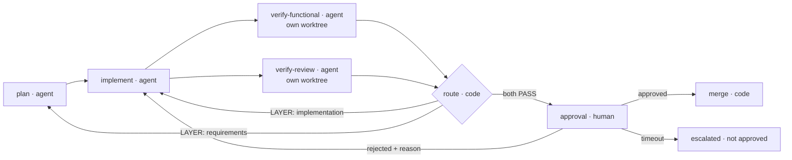

# P08 · The workflow as a graph

Project question: what shows up when you draw the maker-checker loop as an explicit graph, with nodes, edges, shared state and routing rules? Does parallelizing pay off? What does a human node add?

**Base:** the final repo of the P07 maker-checker (app with document search). **New feature for the graph** (`prompts/feature.md`): export the conversation as Markdown, with `conversation.export()` and an "Export conversation" button.

## Experiment 1 · The P07 loop as an explicit graph

`1-explicit-graph/graph.md`: mermaid diagram, node table (agent or code), shared state (who reads and who writes each field) and routing rules of `p07-maker-checker.sh`.

**Implicit edges found** (decisions that existed but were not written down):

1. **"PASS with observations" has no destination.** The P07 checker approved and listed three non-blocking observations; the routing only reads the first line, so they were lost. My own script counted them as "defects".
2. **"No verdict" falls through to FAIL without saying so.** If the checker does not write the file, it goes back to the maker: treating missing evidence as failure is a real decision that was not written down anywhere.
3. **"The agent did not run" does not exist as a state.** In the P07 goal loop, a round with `claude: command not found` counted as "no progress", the same as a round in which the agent worked and failed.
4. **The confirmation is not independent.** The second PASS comes from the same checker on the same code: it confirms stability, it does not add another perspective.

## Experiments 2 and 3 · The executable graph (`scripts/p08-graph.sh`)

- **Shared state:** `state.md` (round, last node, verdicts, approval, request time, human feedback).
- **Fan-out / fan-in:** the two verifiers run in parallel, each in its own git worktree; the fan-in requires both to return PASS.
- **Rollback edge by layer:** each verdict declares `LAYER: implementation` or `LAYER: requirements`; if the problem is in the requirements, the graph goes back to `plan`, not to `implement`.
- **Human-approval node:** if both approve, the graph writes `approval-request.md` (what happened, what changed, why a person is needed, what happens if it is approved or rejected) and **stops**. To continue, a person writes `approved` or `rejected` in `state.md` and runs `p08-graph.sh resume`. If nobody responds within the deadline, `resume` escalates instead of approving.

### Actual run

| Step | Result | Duration | Cost |
|---|---|---|---|
| plan | `spec.md` with 14 acceptance criteria | 53 s | US$0.31 |
| implement | Service, IPC, button and tests | 3:53 | US$1.17 |
| **Sequential** verification (to measure) | functional PASS, review PASS | **186 s** wall-clock | US$1.00 |
| **Parallel** verification (worktrees) | functional PASS, review PASS | **123 s** wall-clock | US$1.01 |
| route | → approval | — | — |
| approval | **Stopped, waiting for a human decision** | — | — |

**Parallelizing:** on the same commit, parallel verification took **34% less wall-clock time** (123 s versus 186 s) for the same cost. The saving is bounded by the slowest verifier (the functional one, which opens the app); the coordination cost was creating and removing two worktrees.

### My own checks

- **Export feature** (`scripts/p08-export-accept.mjs`, hidden from the agents): **6/6**: bridge, Markdown with an empty conversation, question, title and citation excerpt, button in the UI.
- **Regression:** the P06 suite on the graph's result: **12/12**.
- **Timeout rule:** with the deadline at 0 minutes, `resume` set `approval: escalated` and wrote `ESCALATION.md` without approving; with the normal deadline (24 h) it did nothing. Afterwards I restored the state to `pending`.
- **Rollback edge:** this run did not exercise it, because both verifiers approved in the first round. I tested the real routing function with hand-made verdicts (`3-graph/rollback-edge-test.txt`): both PASS → approval; implementation failure → implement; requirements problem → plan; both fail with one on requirements → plan. It is a test of the rule, not a live run of that edge.

## What is still pending: the human decision

The course asks for at least two passes, each with an approval or a rejection from a person. **The graph is stopped at the approval node waiting for that decision**, and I did not simulate it: the point of the node is that a person makes it. To complete it:

1. Read `3-graph/approval-request.md`.
2. In `~/harness-runs/p08-graph/state.md`, change `approval: pending` to `approval: approved` or `approval: rejected` (if rejected, write the reason under `## Feedback`).
3. Run `scripts/p08-graph.sh resume`.

## Failures by layer

| Where | Failure | Layer |
|---|---|---|
| P07 loop (exp. 1) | Checker observations that nobody receives | State (the routing only reads one line) |
| P07 loop (exp. 1) | Infrastructure failure treated as an agent failure | Environment / routing |
| Graph (exp. 3) | The rollback edge to `plan` was only tested as a rule, not live | Experiment design |

## Conclusion

**Drawing the loop as a graph found four decisions nobody had written down**, and one of them (the checker observations that get lost) had gone unnoticed in P07 until it had to be given a destination. The executable graph resolved two: a genuinely different second perspective (functional and code review, in parallel) and a rollback based on the layer of the problem. Parallelizing verification saved a third of the wall-clock time for the same cost. The human-approval node works as designed: the graph stopped, left a readable approval request, and does not approve itself if nobody responds. The feature came out correct according to my own checks (6/6, and 12/12 on regression), and the decision to approve it is, on purpose, left to a person.
